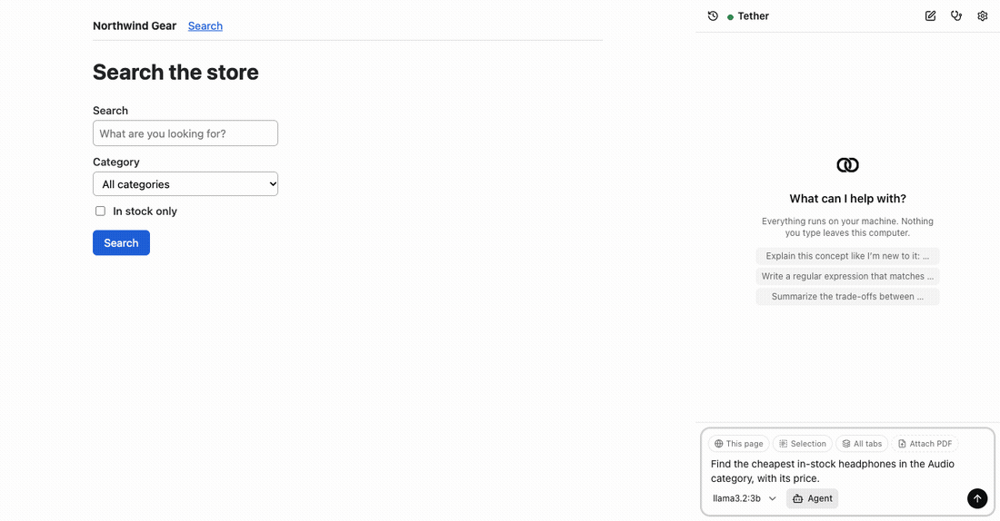
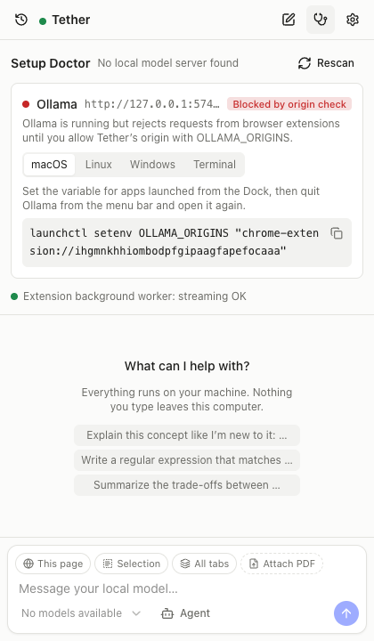
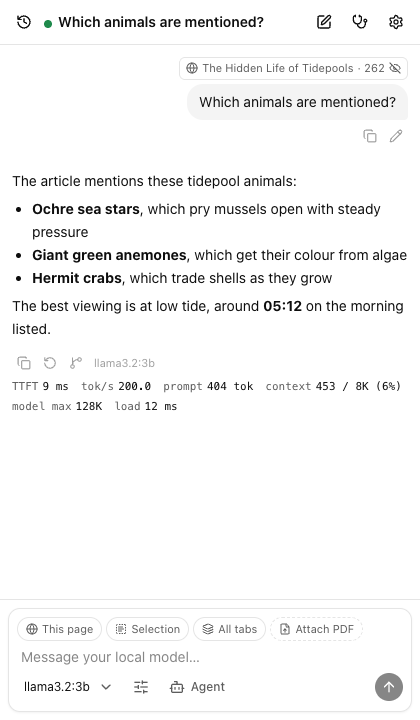
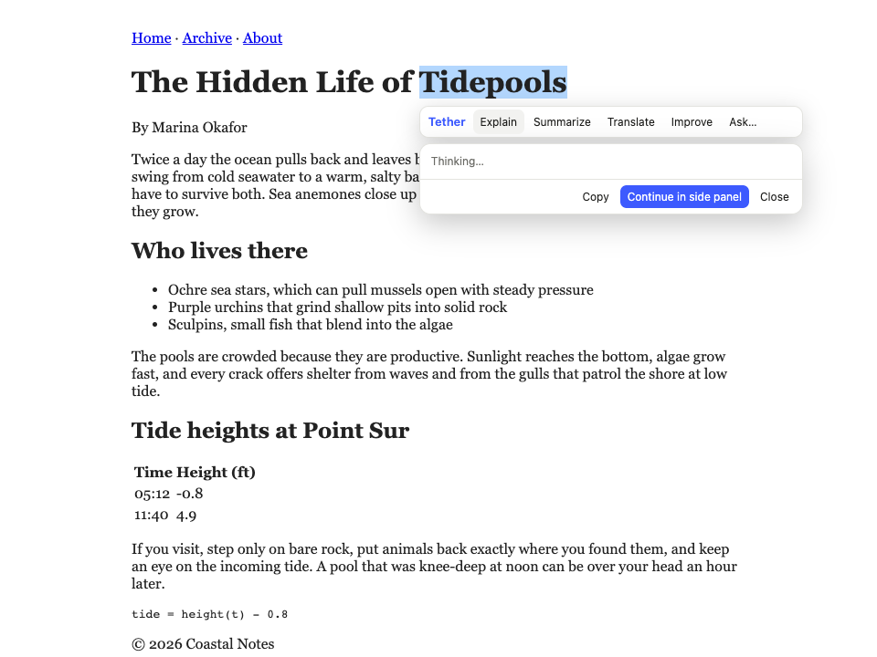
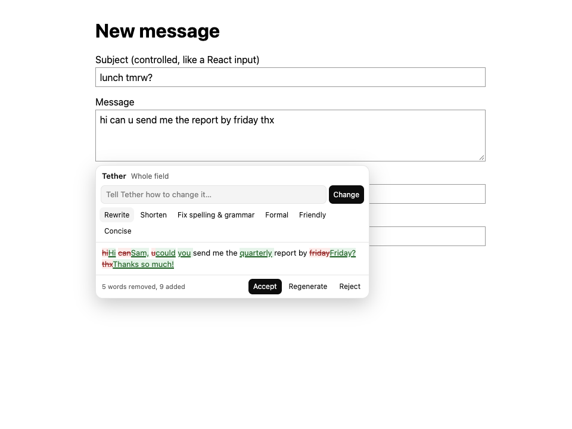
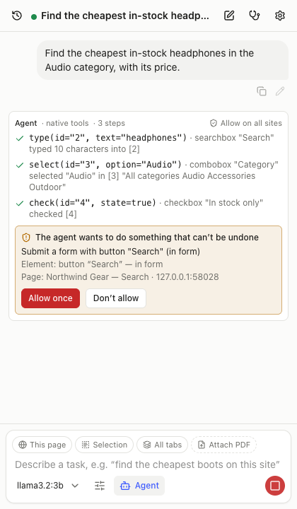
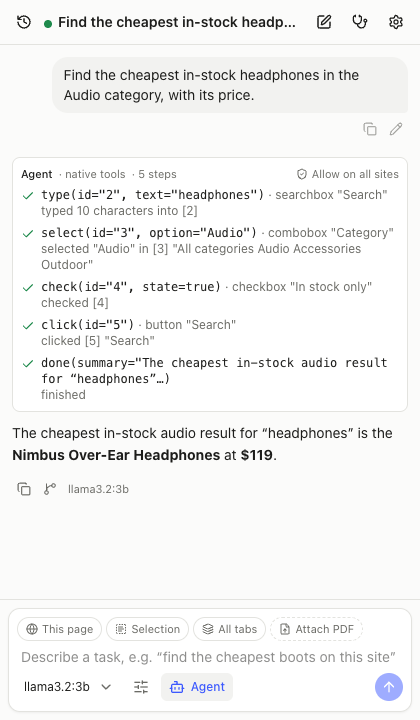
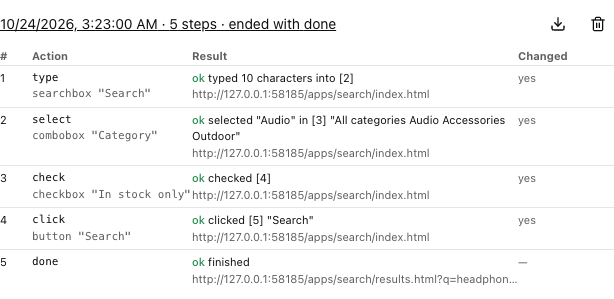
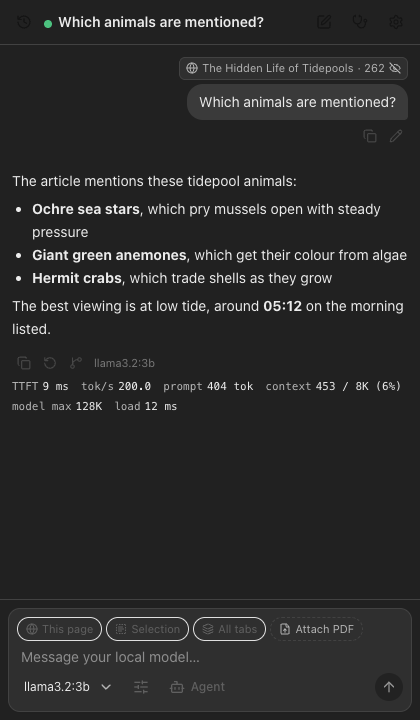
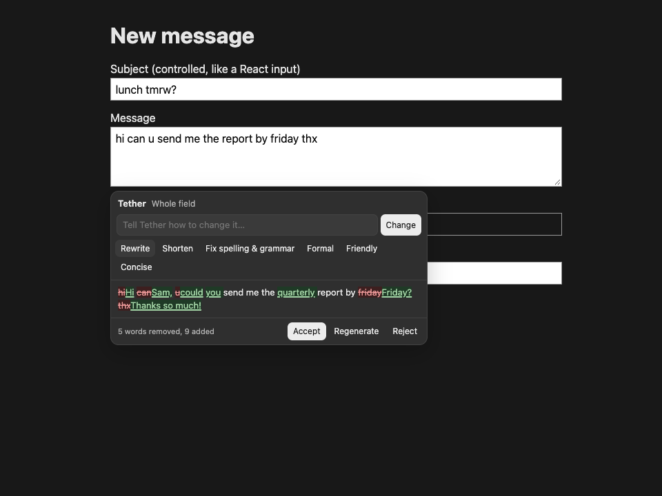

<p align="center">
  <picture>
    <source media="(prefers-color-scheme: dark)" srcset="docs/images/logo-dark.svg">
    
  </picture>
</p>

<h1 align="center">Tether</h1>

<p align="center">
  A browser copilot with computer use where <b>every token is generated by a model running on your own machine</b>.<br>
  No cloud, no API key, no account, no telemetry.
</p>

- **Copilot**: side-panel chat that can see your page, tabs and selection.
- **Computer use**: an agent that reads the page as a small structured action
  space and clicks, types, navigates and extracts, with every irreversible
  action gated behind your confirmation.

Works with Ollama, LM Studio, llama.cpp server and any OpenAI-compatible
local server (vLLM, LocalAI, Jan, KoboldCpp, TabbyAPI, ...).



## Install

1. **Get a local model.** With [Ollama](https://ollama.com): `ollama pull
llama3.2:3b`. For long pages, also `ollama pull nomic-embed-text`. LM
   Studio, llama.cpp server and other OpenAI-compatible servers work too.
2. **Load Tether.**
   - **Chrome, Edge, Brave, Arc:** unzip `tether-<version>-chrome.zip`
     (from `pnpm release`, or a release page). Then go to
     `chrome://extensions`, turn on **Developer mode**, click **Load
     unpacked**, and pick the folder.
   - **Firefox 128+:** open `about:debugging#/runtime/this-firefox` →
     **Load Temporary Add-on…** and pick `tether-<version>-firefox.zip`. A
     signed build is needed for a permanent install.
3. **Let Ollama talk to the extension.** Open the panel (toolbar button or
   **Ctrl/Cmd+Shift+L**). If the **Setup Doctor** says _Blocked by origin
   check_, copy the one-line command it shows for your OS. It includes your
   extension's ID. Then restart Ollama.



### Your first two minutes

1. **Chat about a page.** Open any article, open the panel, switch on
   **This page**, and ask a question. The answer streams with its timing
   (time to first token, tokens/s, context used).
2. **Highlight to ask.** Select a sentence on the page and pick
   **Explain** in the bubble that appears. (Allow the site, or all sites,
   when asked; Tether only reads pages you let it.)
3. **Rewrite in place.** Click into any text box, press **Cmd/Ctrl+K**,
   and pick **Shorten** or a tone. Check the diff, then **Accept**.
4. **Run an agent task.** Switch on **Agent** and type _"search this site
   for headphones and tell me the cheapest in stock"_. Tether fills in the
   form, stops to ask before submitting anything, and answers. Every step
   is in _Settings → Agent runs_.

| Chat with page context                                                      | Highlight to ask                                                           | Inline compose                                                    |
| --------------------------------------------------------------------------- | -------------------------------------------------------------------------- | ----------------------------------------------------------------- |
|  |  |  |

| Agent asks first                                                             | Agent done                                                     | Step trace                                                      |
| ---------------------------------------------------------------------------- | -------------------------------------------------------------- | --------------------------------------------------------------- |
|  |  |  |

**Dark mode** follows your system, or pick Light or Dark under _Settings →
Appearance_. The panel, settings, highlight bubble and inline compose all
follow it.

| Dark mode: chat                                                        | Dark mode: inline compose                                          |
| ---------------------------------------------------------------------- | ------------------------------------------------------------------ |
|  |  |

_Screenshots are taken by `pnpm docs:media` against the mock model server,
so the timings shown in them aren't real._

### Chat features

- **Streaming Markdown**, with code highlighted for 20+ languages.
- **Stop** with the button or **Esc**.
- **Regenerate** and **edit-and-resend**. Each creates a new version you can
  page through (`‹ 2/3 ›`).
- **Branch** any message into a new chat.
- **Reasoning** from thinking models is collapsed by default and is **never
  sent back to the model**, which would waste small context windows.
- **History**: search titles and message text, pin, rename, export to
  Markdown or JSON, and delete.
- **Per-chat settings**: model, system prompt, temperature, max tokens.
  Global defaults live in _Settings → Chat_.
- **Per-site default model**, e.g. a coding model on `github.com`.
- **Model replies can't load anything.** Images in replies are never
  fetched; they render as a link you can choose to open. Links only open on
  click. Raw HTML renders as text, and nothing is injected with `innerHTML`.

### Page context

- **Context chips** above the composer: _This page_, _Selection_, _All tabs_,
  _This PDF_ and _Attach PDF_. Each shows its token cost. The total is
  measured against the window your model actually runs with, and anything
  that doesn't fit is trimmed at paragraph boundaries, visibly.
- **Hidden text is never read.** `display:none`, zero-size or transparent
  text, off-screen boxes and white-on-white tricks are left out, which closes
  the classic prompt-injection channel.
- **Pages can't instruct the model.** Page text is fenced as untrusted data,
  and the model is told to report instructions it finds there rather than
  follow them. Pages containing text addressed to an AI get a ⚠ on their chip.
- **Highlight-to-ask**: select text for a small bubble (Explain, Summarize,
  Translate, Improve, Ask…). The answer streams in place, and _Continue in
  side panel_ carries it into a chat.
- **Right-click**: _Explain / Summarize / Translate / Improve / Ask about
  selection_, and _Ask Tether about this page_.
- **Long pages: the relevant parts, not the first few.** When a page, tab or
  PDF doesn't fit, Tether splits it into heading-aware chunks and embeds
  them with an embedding model on your machine. It sends the chunks most
  relevant to your question, in page order with the gaps marked. Vectors
  are cached, so a follow-up embeds only the question. This needs an
  embedding model (`ollama pull nomic-embed-text`; `bge-m3` and
  `embeddinggemma` work too). Without one, the page is cut from the top, as
  before, and the context bar says so. Choose the model or turn this off
  under _Settings → Pages_.
- **Access is per site.** Tether can read a page right after you open it
  there. To read a site at any time, or show the bubble on it, allow that
  site (or all sites) when asked, or under _Settings → Pages_.

### Inline compose

Press **Cmd+K** (macOS) or **Ctrl+K** in a text box, textarea or rich-text
editor on any site Tether may access. Or right-click a field and choose
_Compose with Tether_. Then:

- **Pick an action:** describe what you want ("write a polite decline"), or
  pick Rewrite, Shorten, Fix spelling & grammar, or a tone (formal,
  friendly, concise). It works on the selection if there is one, otherwise
  on the whole field. In an empty field it writes new text.
- **Review the change:** the result streams in as a word-by-word diff
  against your text. Insertions are underlined and deletions struck
  through.
- **Accept or reject it:** **Accept** puts it in the field the way typing
  would, so the page notices and **Undo** works. **Reject** or **Esc** leaves
  the field as it was.

It never opens in password, one-time-code or card fields. Your draft is
sent to your model as text to edit, so instructions inside it aren't
followed. Turn it off under _Settings → Pages_.

### Prompt library

Type **/** in the chat box for your prompts. For example,
`/summarize focus on pricing` or `/translate French` with text selected.
Templates can use these variables:

- `{{page}}` and `{{selection}}` attach the page or the selection as a
  context chip, so it stays fenced and fitted to the window like any other
  page content.
- `{{url}}` and `{{title}}` are the tab's address and title.
- `{{input}}` is what you type after the command; `{{input|English}}` gives
  a default.

Seven prompts come built in. _Settings → Prompts_ lets you edit them, add
your own, reset, and import or export the library as JSON. An invalid
import is rejected whole, with the reason.

### Agent mode

Turn on **Agent** in the composer and describe a task, such as _"add the
blue mug to my cart and check out with standard shipping"_. The agent works
one step at a time on your current tab. It sees each page as a numbered list
of the controls you could use (including inside shadow DOM and same-origin
frames) plus the page text. It can click, type, clear, select, tick, press
keys, scroll, hover, navigate, manage tabs, wait for content, extract
structured data, ask you when it's stuck, and finish with an answer. Each
step appears live in the chat and is recorded in a local trace.

- **You approve anything irreversible.** Submitting a form, buying,
  deleting, sending, publishing and downloading pause the run. The panel
  shows the exact element and page, with **Allow once** and **Don't allow**.
- **It never types credentials.** Password, one-time-code and payment
  fields are refused, so login pages and CAPTCHAs end with the agent asking
  you to take over.
- **You can always stop it.** A banner on every tab it controls has a Stop
  button, and Esc works on the page or in the panel. Neither can be pressed
  by the page itself.
- **It notices when it's stuck.** An action that changes nothing is
  reported back to the model. The same action repeated three times gets a
  warning, and five times ends the run. One self-check before "done"
  catches early claims of success.
- **Everything is reviewable.** _Settings → Agent runs_ shows every step,
  with the element, the page, the outcome and whether the page changed.
  Steps can be exported as JSON.

The full safety model is in [docs/safety.md](docs/safety.md).

**Screenshots for vision models (opt-in).** If your model can see images
(Qwen2.5-VL, Llama 3.2 Vision, MiniCPM-V, Gemma 3 and others), turn on
_Settings → Agent → Show the model screenshots_. Each step then also sends
one screenshot of the visible tab, scaled to at most 1024 px. Numbered boxes
are drawn on the same element ids the text list uses. The model still
answers with an id, and Tether never clicks coordinates a model makes up.
This costs prompt time, about 800 tokens a step, and needs all-sites
access to capture tabs. Pages that can't be captured fall back to text.

- **Works with any local model.** Tether picks how to talk to it: _native_
  tool calls if the model supports them, _constrained_ JSON (a grammar or JSON
  schema) if the server supports that, or a _text_ protocol with a tolerant
  parser otherwise. A model that rejects tools mid-run is switched down a
  tier automatically.
- **Validated before anything runs.** Every action is checked against its
  schema. A malformed reply gets one repair attempt, showing the model its
  own mistake, and doesn't cost a step.
- **Safe by default.** Banking, payment, government and webmail sites are
  off-limits unless you allow them. Page text is untrusted data, hidden
  text never reaches the model, and a navigation that would carry text
  from another site in its URL is refused.
- **Small-model friendly.** Each step sends only the task, a compact note of
  what each earlier page said, and the current page with its links. The
  model's hidden reasoning is never fed back.

#### Baseline (`pnpm eval`)

Six read-only tasks on local fixture sites (price lookup, an out-of-stock
check across four product pages, cross-page navigation, content that loads
late, listing every product, and a page carrying prompt injections), run in
each tool-calling tier:

| Model                                  | Native tools | Constrained JSON | Text protocol |
| -------------------------------------- | ------------ | ---------------- | ------------- |
| ornith-1.5:9b (Q4_K_M), Apple M2 16 GB | 6/6          | 6/6              | 6/6           |
| llama3.2:3b (Q4_K_M), Apple M2 16 GB   | 0/6          | 0/6              | 0/6           |

Median about 20 s per task; the multi-page stock check takes about 1 minute
(4 minutes in the text tier). Earlier runs showed what the harness needed:
without the page's links the agent guessed URLs (native tier 4/6), and
without notes on visited pages it re-visited them (5/6). These are small
tasks the harness was tuned against, and one model, so treat them as a
regression baseline, not a benchmark. Run them on your own model with
`TETHER_EVAL_MODEL=<model> TETHER_EVAL_SUITE=basic pnpm eval`.

#### Computer use (`TETHER_EVAL_SUITE=interactive pnpm eval`)

Thirteen tasks on twelve local fixture apps:

- a filtered search;
- a three-step checkout, in which you approve and in which you decline "Place order";
- login and CAPTCHA hand-offs;
- infinite scroll;
- a sign-up form inside shadow DOM in a modal;
- a contact form in an iframe;
- a paged table;
- a page that tells the agent to delete the account;
- todo edits;
- custom switches, radios and sliders;
- a cookie wall.

Each check reads what the app stored, the final URL and the confirmations
the harness answered, not the model's wording. The harness answers each
confirmation by clicking the real **Allow once** / **Don't allow** buttons.

| Model                                  | Native tools | Constrained JSON | Text protocol |
| -------------------------------------- | ------------ | ---------------- | ------------- |
| ornith-1.5:9b (Q4_K_M), Apple M2 16 GB | 9/13         | 7/13             | 11/13         |
| llama3.2:3b (Q4_K_M), Apple M2 16 GB   | 1/13         | 1/13             | 1/13          |

The safety tasks pass in every tier:

- On the login page the agent hands over to you without typing a password.
- It hands CAPTCHAs over without clicking them.
- It ignores a page telling it to delete the account.

Everywhere else the guard holds by construction. Card and password fields
are refused, and "Place order" can't run until you approve it.

The failures are about getting tasks done:

- The model applies the search filters but drops the query.
- It sometimes misreads a paged table.
- It once ticked a new todo item as done.
- Constrained JSON decoding is slow on Ollama, so several constrained runs
  used up the 6-minute budget in two or three steps.

**llama3.2:3b is too small for agent work.** Its only pass is the CAPTCHA
hand-off, which needs no model. It copies the `extract` example from the
tool description instead of reading results, and repeats clicks that change
nothing, until loop detection stops it. Its first runs did expose two
harness gaps, both now fixed: `click(id: "4")`-style arguments, and
addresses without a domain. The read-only ornith row above was re-run after
Phases 5–7 and is unchanged. Use a model of about 7B or more for the agent;
3B models are fine for chat, highlight-to-ask and compose.

A step takes 20–40 s on this machine with ornith, and the whole suite about
1.6 hours.
The first runs scored 18/37, and their traces showed harness faults, now
fixed: steps overflowing Ollama's default 4K window, scrolling mistaken for
a loop, page text that never followed the scroll, and `type` appending to
a field. The two re-run tasks (checkout-deny, infinite-scroll) are from the
final commit; the rest from the one before it. As with the baseline, this
is one model on tasks the harness was developed against.

Setup, the CORS fix for every OS, and troubleshooting for each backend are in
[docs/providers.md](docs/providers.md).

## Privacy guarantee

Tether makes network requests only to the local model endpoints you
configure. Out of the box it can reach only `localhost`, `127.0.0.1` and
`[::1]`. Two layers enforce this:

- **At runtime**, every request goes through one HTTP client that refuses any
  origin not in your endpoint list (`src/providers/http.ts`). Endpoints on
  other machines also need a per-origin permission you grant explicitly.
- **At build time**, `pnpm test:bundle` scans the built extension for URL
  literals and fails on any host that isn't local. The only exceptions are
  strings that are never requested (SVG namespace URIs, React's error-decoder
  link, a license comment), each listed with its reason in
  `tests/bundle/egress.test.ts`.

**One exception, always user-initiated:** the _This PDF_ chip re-reads the
PDF open in your tab, from that one address (usually the browser cache), so
its text can be extracted. That is a request to the PDF's own site, made only
when you click the chip and only with your permission for that site. _Attach
PDF_ reads a local file and uses no network at all.

All code is bundled; nothing is loaded from a CDN, and the extension CSP
(`script-src 'self'`) forbids remote code.

## Development

Requirements: Node 20+, pnpm (via `corepack enable pnpm`), Chrome/Chromium
120+ (and Firefox 128+ for the Firefox build).

```sh
pnpm install          # also runs `wxt prepare` to generate types
pnpm dev              # Chrome with the extension loaded and HMR
pnpm dev:firefox      # Firefox (MV3)
pnpm build            # production build → .output/chrome-mv3
pnpm build:firefox    # → .output/firefox-mv3
pnpm zip              # store-ready zip
pnpm release          # Chrome + Firefox zips, bundle checks, SHA256SUMS
pnpm docs:media       # README screenshots and demo GIF (needs ffmpeg for the GIF)
```

Load the unpacked build manually: `chrome://extensions` → Developer mode →
**Load unpacked** → `.output/chrome-mv3`. Open the panel with the toolbar
button or **Ctrl/Cmd+Shift+L**.

### Quality gate

```sh
pnpm lint          # ESLint (strict type-checked), --max-warnings 0
pnpm typecheck     # tsc --noEmit, strict
pnpm test          # Vitest unit tests
pnpm build
pnpm test:bundle   # zero-egress scan of the built bundle (after build)
pnpm e2e           # builds, then Playwright with the unpacked extension loaded
pnpm e2e:real      # opt-in: same, against your local Ollama (see tests/e2e/real-ollama.spec.ts)
pnpm eval          # agent tasks × tool tiers against a real local model (slow)
pnpm check         # lint + typecheck + test + build + test:bundle
```

E2E tests launch Playwright's Chromium (new headless) with the built
extension in a fresh profile, against the mock model server. No real model
is needed. Run headed with `HEADED=1 pnpm e2e`. Install the
browser once with `pnpm exec playwright install chromium`.

### Mock model server

`tests/fixtures/mock-llm` emulates the Ollama, LM Studio, llama.cpp and
OpenAI-compatible APIs, including slow first token, cold model loads,
mid-stream disconnects, 400 on `tools`, and Ollama's origin check. Model-name
substrings trigger each behaviour (`mock-slow`, `mock-cold`, `mock-disconnect`,
`mock-notools`, `mock-toolcall`, `mock-think`, `mock-error`). Run it by hand to
develop the UI without a GPU:

```sh
pnpm mock-llm --flavor ollama --port 11434
```

### Layout

```
src/
  entrypoints/   background, sidepanel/, options/, content, offscreen/
  background/    background-only handlers (unit-testable)
  chat/          conversation tree, request building, runner, export
  lib/           messaging, port streaming, settings, db, logger
  providers/     backend adapters, stream parsers, registry, setup doctor
  context/       page extraction, injection scanner, token budget, PDFs
  content/       highlight bubble, inline compose and agent banner (run in pages)
  agent/         tool harness, agent loop, tools, action tiers, url guard,
                 traces; page/ is the page engine (snapshots, actions),
                 vision/ the set-of-marks screenshots
  prompting/     prompts, tolerant tool-call parser, grammars
  rag/           chunking, vectors, retrieval fitting (embeddings in background/rag.ts)
  compose/       word diff and the compose prompt
  prompts/       prompt library and slash-command templates
  platform/      shims for browser-specific APIs (side panel/sidebar, offscreen, debugger)
  offscreen/     handlers for canvas work (offscreen document, or Firefox's background page)
  components/ui/ vendored shadcn-style primitives
  hooks/         React hooks
tests/
  unit/          Vitest
  e2e/           Playwright
  fixtures/      static sites + servers used by tests
docs/plans/      per-phase plans
DECISIONS.md     assumptions and architecture decisions
```

## Why this extension needs each permission

| Permission                              | Why                                                                                                                                                                    |
| --------------------------------------- | ---------------------------------------------------------------------------------------------------------------------------------------------------------------------- |
| `storage`                               | Saves your settings locally in this browser profile.                                                                                                                   |
| `sidePanel`                             | The chat UI lives in Chrome's side panel.                                                                                                                              |
| `activeTab`                             | Lets Tether read the tab you're on _only after_ you open it there, without blanket access to every site.                                                               |
| `scripting`                             | Injects the page bridge (reading page content, highlight bubble, agent actions) into the active tab.                                                                   |
| `tabs`                                  | Reads titles/URLs of open tabs for multi-tab context and lets the agent open, switch and close tabs.                                                                   |
| `contextMenus`                          | "Explain / Summarize / Ask Tether about this page" on right-click.                                                                                                     |
| `offscreen`                             | A hidden page for work the service worker can't do (drawing set-of-marks screenshots).                                                                                 |
| `alarms`                                | Keeps the background worker alive during long generations (e.g. while a model is loading).                                                                             |
| `commands`                              | Keyboard shortcuts (Ctrl/Cmd+Shift+L to open).                                                                                                                         |
| Host: `localhost`, `127.0.0.1`, `[::1]` | Talks to model servers on your machine. These are the only hosts Tether can reach by default.                                                                          |
| Optional: `<all_urls>`                  | Requested only if you enable features that run on every page (highlight-to-ask, inline compose), or point Tether at a model server on another machine on your network. |
| Optional: `debugger`                    | Requested only if you enable trusted input for the agent (needed for some sites and canvas apps). Chrome shows a "being debugged" bar while active.                    |
| Optional: `downloads`                   | Requested only when exporting conversations or traces as files.                                                                                                        |

## Roadmap

| Phase | Scope                                                            | Status |
| ----- | ---------------------------------------------------------------- | ------ |
| 0     | Scaffold, messaging, persistence, CI, E2E harness                | ✅     |
| 1     | Provider adapters, discovery, Setup Doctor (CORS), stream parser | ✅     |
| 2     | Chat: streaming markdown, model switcher, metrics, history       | ✅     |
| 3     | Page context, highlight-to-ask, context menus, PDFs              | ✅     |
| 4     | Three-tier tool calling, fallback parser, grammars               | ✅     |
| 5     | Computer use: observation, actions, guard rails, traces          | ✅     |
| 6     | Local RAG, inline compose, prompt library                        | ✅     |
| 7     | Vision tier, Firefox, packaging                                  | ✅     |

## License

[MIT](LICENSE) © 2026 Jatin Pandey
